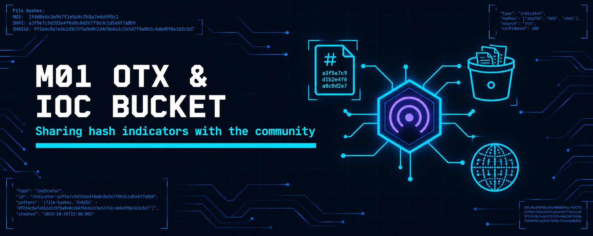
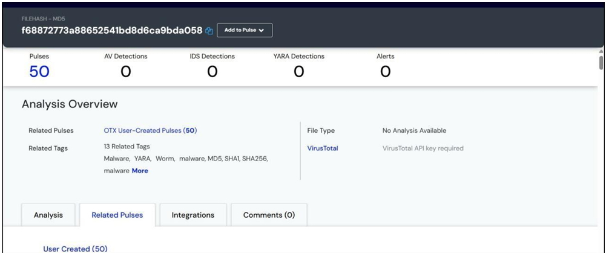
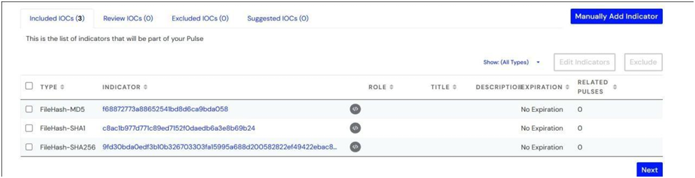
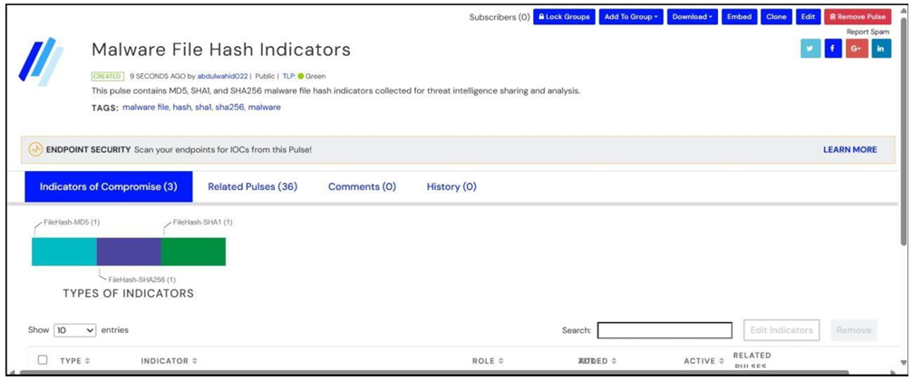

  

<h1>M01 — AlienVault OTX and IOC Bucket</h1>
<h3>Searching, publishing and sharing malware hash indicators on community platforms</h3>

 

  

<a href="#overview"><b>Overview</b></a> &nbsp;·&nbsp;
<a href="#tasks-and-results"><b>Tasks</b></a> &nbsp;·&nbsp;
<a href="#evidence"><b>Evidence</b></a> &nbsp;·&nbsp;
<a href="#full-report"><b>Report</b></a>

 

---

## Overview

A threat intelligence sharing lab on two community platforms. A malware MD5 is searched on AlienVault OTX, its three hashes are extracted into a new pulse and published, and the same indicators are contributed to IOC Bucket. OTX was used in place of ThreatConnect, which the lab manual names, because it offers equivalent sharing features on a free account.

 

## Tasks and Results

<table>
<tr><th>Task</th><th>Activity</th><th>Result</th></tr>
<tr><td><b>1a</b></td><td>Search MD5 <code>f68872773a88652541bd8d6ca9bda058</code> on OTX</td><td>Referenced in 50 user-created pulses with 13 related tags</td></tr>
<tr><td><b>1b</b></td><td>Extract indicators from pasted MD5, SHA-1 and SHA-256 values</td><td>3 indicators identified: FileHash-MD5, FileHash-SHA1, FileHash-SHA256</td></tr>
<tr><td><b>1c</b></td><td>Publish the pulse <i>Malware File Hash Indicators</i></td><td>TLP:GREEN, 3 IOCs, 36 related pulses associated automatically</td></tr>
<tr><td><b>2</b></td><td>Upload a single IOC to IOC Bucket</td><td>Success notification confirmed the contribution to the community feed</td></tr>
</table>

 

### Indicators shared

<table>
<tr><th>Type</th><th>Value</th></tr>
<tr><td><b>MD5</b></td><td><code>f68872773a88652541bd8d6ca9bda058</code></td></tr>
<tr><td><b>SHA-1</b></td><td><code>c8ac1b977d771c89ed7152f0daedb6a3e8b69b24</code></td></tr>
<tr><td><b>SHA-256</b></td><td><code>9fd30bda0edf3b10b326703303fa15995a688d200582822ef49422ebac87b7f7</code></td></tr>
</table>

 

## Evidence

   
  Task 1: MD5 indicator analysis showing 50 related pulses

   
  Task 1: three file hash indicators extracted and included

   
  Task 1: published pulse with 3 indicators and 36 related pulses

   
  Task 2: IOC Bucket confirms the IOC was uploaded

 

## Tools

<code>AlienVault OTX</code> <code>IOC Bucket</code>

 

## Full Report

📄 **[OTX-and-IOC-Bucket.pdf](./OTX-and-IOC-Bucket.pdf)**: both tasks with every step and figure.

 

⬅ <a href="../README.md"><b>Back to Main Repository</b></a>

