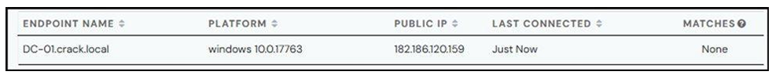
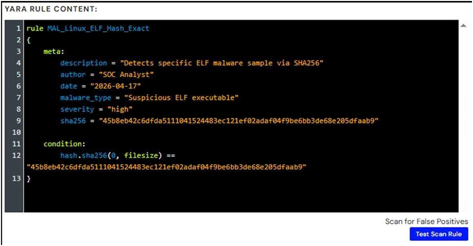
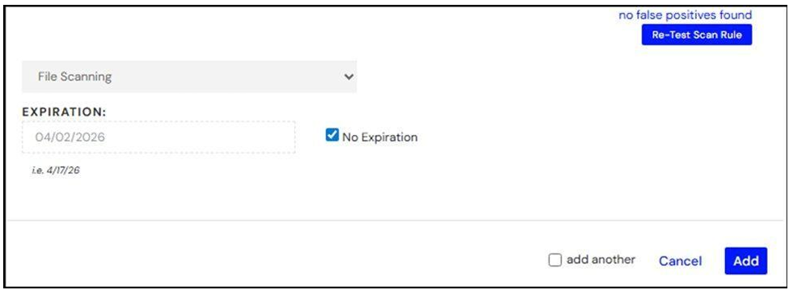
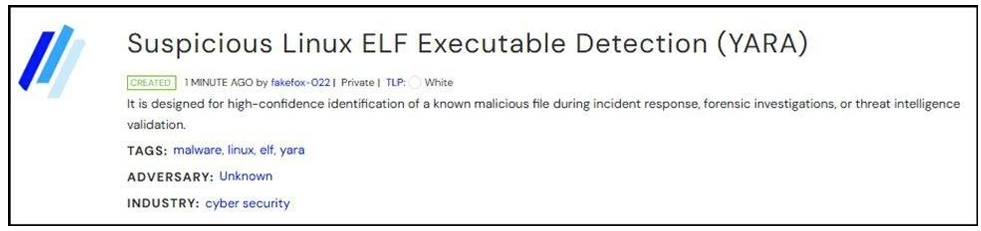
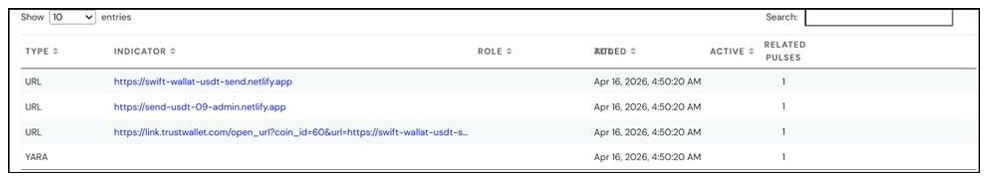

  

<h1>M02 — AlienVault OTX and YARA</h1>
<h3>The threat intelligence lifecycle from collection to a custom YARA indicator</h3>

 

  

<a href="#overview"><b>Overview</b></a> &nbsp;·&nbsp;
<a href="#tasks-and-results"><b>Tasks</b></a> &nbsp;·&nbsp;
<a href="#evidence"><b>Evidence</b></a> &nbsp;·&nbsp;
<a href="#full-report"><b>Report</b></a>

 

---

## Overview

A four-task lab that walks the full lifecycle on AlienVault OTX: collecting indicators from community pulses, scanning an endpoint with the OTX agent, writing a custom YARA indicator for a Linux ELF sample from MalwareBazaar, and reviewing the sharing options. The lab ran on a Windows 10 virtual machine with Windows Defender disabled so the agent and samples could run without interference.

 

## Tasks and Results

<table>
<tr><th>Task</th><th>Activity</th><th>Result</th></tr>
<tr><td><b>1</b></td><td>IoC data collection from subscribed pulses</td><td>Pulse <i>Silent Crypto Wallet Takeover</i> reviewed: 4 IoCs (3 phishing URLs and 1 YARA rule) and 18+ ATT&amp;CK techniques</td></tr>
<tr><td><b>2</b></td><td>Threat analysis with OTX Endpoint Security</td><td>Agent installed through PowerShell; endpoint registered on Windows 10.0.17763 with no matches</td></tr>
<tr><td><b>3</b></td><td>Custom YARA indicator for an ELF sample</td><td>Rule <code>MAL_Linux_ELF_Hash_Exact</code> matches the exact SHA-256; the OTX test returned no false positives; role <code>file_scanning</code>, no expiration</td></tr>
<tr><td><b>4</b></td><td>Sharing and dissemination</td><td>Pulse <i>Suspicious Linux ELF Executable Detection (YARA)</i> published as TLP:WHITE (private); sharing actions reviewed: subscribe, download CSV, OpenIOC and STIX, embed, clone, suggest edit</td></tr>
</table>

 

## Evidence

   
  Task 2: endpoint registered in OTX Endpoint Security

   
  Task 3: YARA rule with SHA-256 condition and the Test Scan Rule button

   
  Task 3: OTX reports no false positives for the rule

   
  Task 3: published pulse header with TLP:WHITE and tags

   
  Task 4: IoC details of a public community pulse

 

## Tools

<code>AlienVault OTX</code> <code>OTX Endpoint Security</code> <code>YARA</code> <code>MalwareBazaar</code> <code>PowerShell</code>

 

## Full Report

📄 **[OTX-and-YARA.pdf](./OTX-and-YARA.pdf)**: all four tasks with every step and figure.

 

⬅ <a href="../README.md"><b>Back to Main Repository</b></a>

