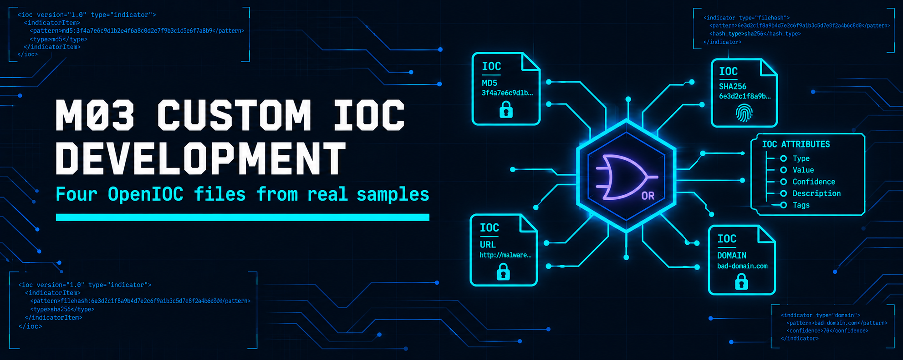
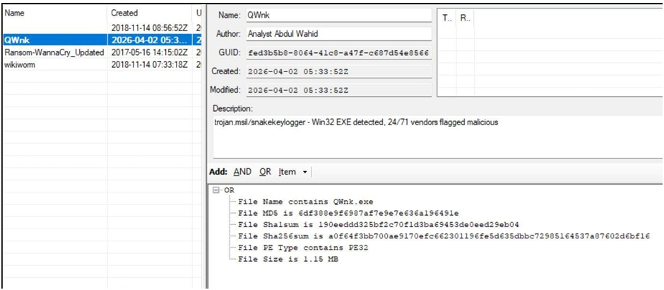
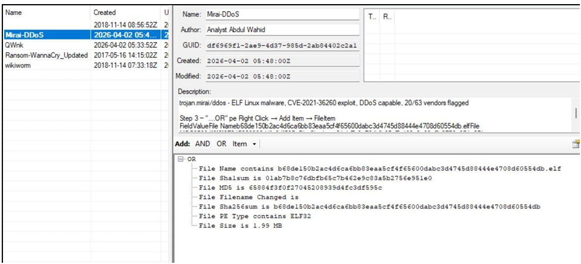
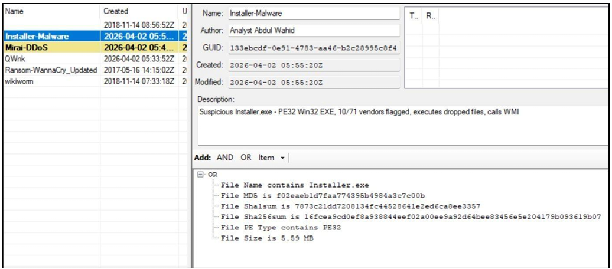
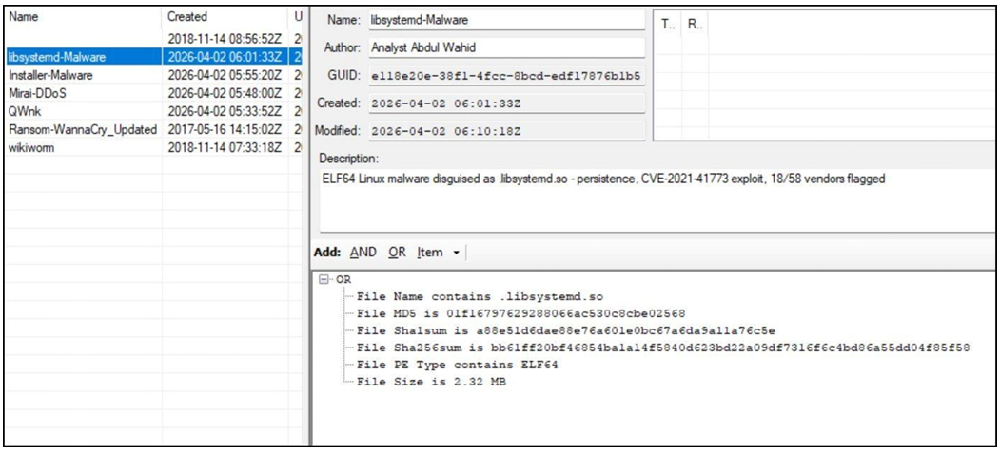
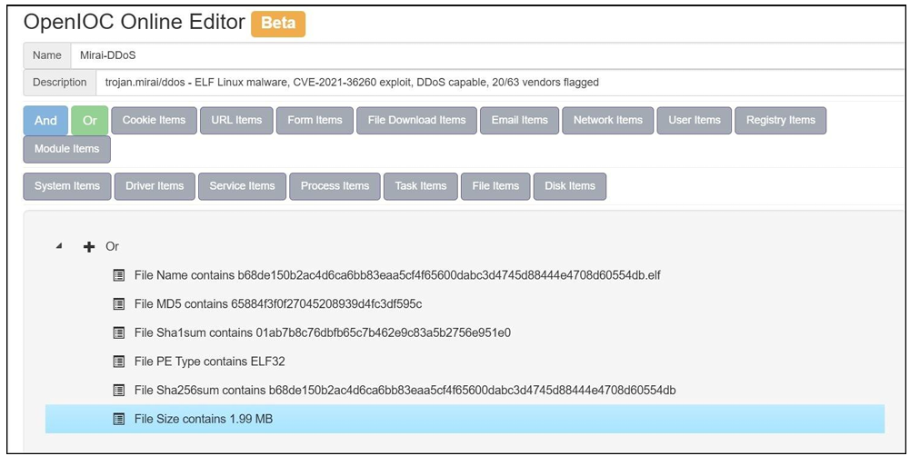
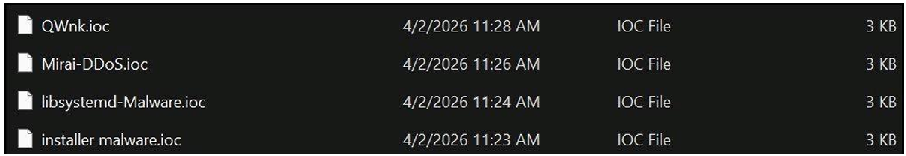

  

<h1>M03 — Custom IOC Development (OpenIOC)</h1>
<h3>Four OpenIOC files built from real samples and validated in a second editor</h3>

 

  

<a href="#overview"><b>Overview</b></a> &nbsp;·&nbsp;
<a href="#tasks-and-results"><b>Results</b></a> &nbsp;·&nbsp;
<a href="#evidence"><b>Evidence</b></a> &nbsp;·&nbsp;
<a href="#full-report"><b>Report</b></a>

 

---

## Overview

Four samples from MalwareBazaar are profiled in VirusTotal and encoded as OpenIOC indicators with Mandiant IOCe 2.2.0, then rebuilt in the IOC Bucket OpenIOC Online Editor for validation. Each IOC records the file name, MD5, SHA-1, SHA-256, PE type and file size under an OR logic block. The workflow per sample: select the sample, check it on VirusTotal, build the indicator in IOCe, save the `.ioc` file, repeat in IOC Bucket.

 

## Tasks and Results

<table>
<tr><th>IOC</th><th>Threat label</th><th>Platform</th><th>Size</th><th>VT detections</th><th>CVE</th></tr>
<tr><td><b>QWnk</b></td><td><code>trojan.msil/snakekeylogger</code></td><td>Win32 PE32, .NET</td><td>1.15 MB</td><td>24/71</td><td>None noted</td></tr>
<tr><td><b>Mirai-DDoS</b></td><td><code>trojan.mirai/ddos</code></td><td>ELF32 MIPS, UPX packed</td><td>1.99 MB</td><td>20/63</td><td>CVE-2021-36260</td></tr>
<tr><td><b>Installer-Malware</b></td><td>Suspicious PE32 installer and dropper</td><td>Win32 PE32, .NET</td><td>5.59 MB</td><td>10/71</td><td>None noted</td></tr>
<tr><td><b>libsystemd-Malware</b></td><td>ELF64 persistence malware</td><td>ELF64 x86-64, UPX packed</td><td>2.32 MB</td><td>18/58</td><td>CVE-2021-41773</td></tr>
</table>

 

### SHA-256 identifiers

<table>
<tr><th>IOC</th><th>SHA-256</th></tr>
<tr><td><b>QWnk</b></td><td><code>a0f64f3bb700ae9170efc662301196fe5d635dbbc72985164537a87602d6bf16</code></td></tr>
<tr><td><b>Mirai-DDoS</b></td><td><code>b68de150b2ac4d6ca6bb83eaa5cf4f65600dabc3d4745d88444e4708d60554db</code></td></tr>
<tr><td><b>Installer-Malware</b></td><td><code>16fcea9cd0ef8a938844eef02a00ee9a92d64bee83456e5e204179b093619b07</code></td></tr>
<tr><td><b>libsystemd-Malware</b></td><td><code>bb61ff20bf46854ba1a14f5840d623bd22a09df7316f6c4bd86a55dd04f85f58</code></td></tr>
</table>

 

## Evidence

   
  QWnk: file name, MD5, SHA-1, SHA-256, PE type and size in the OR block

   
  Mirai-DDoS: completed ELF32 indicator

   
  Installer-Malware: completed PE32 indicator

   
  libsystemd-Malware: completed ELF64 indicator

   
  The Mirai-DDoS IOC rebuilt in the IOC Bucket OpenIOC Online Editor

   
  The four saved <code>.ioc</code> files

 

## Tools

<code>Mandiant IOCe 2.2.0</code> <code>IOC Bucket OpenIOC Editor</code> <code>VirusTotal</code> <code>MalwareBazaar</code>

 

## Full Report

📄 **[Custom-IOC-Development.pdf](./Custom-IOC-Development.pdf)**: all four IOCs with VirusTotal evidence and IOC Bucket validation.

 

⬅ <a href="../README.md"><b>Back to Main Repository</b></a>

