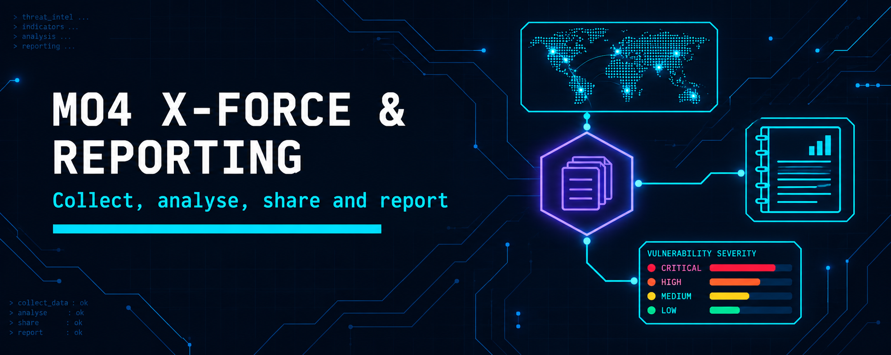
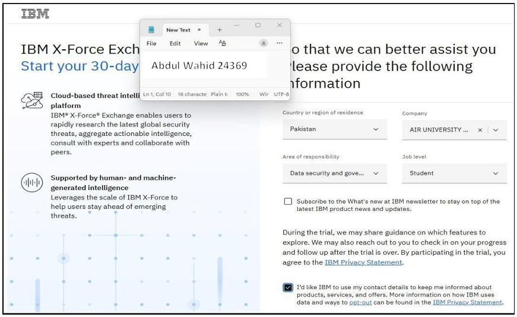
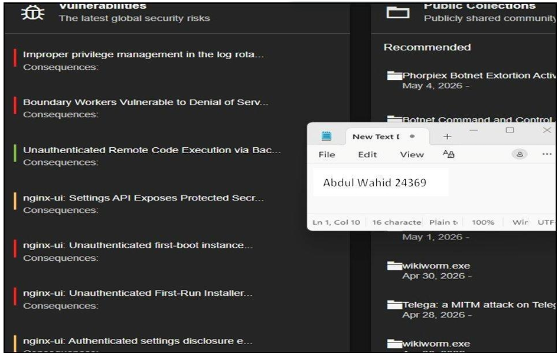
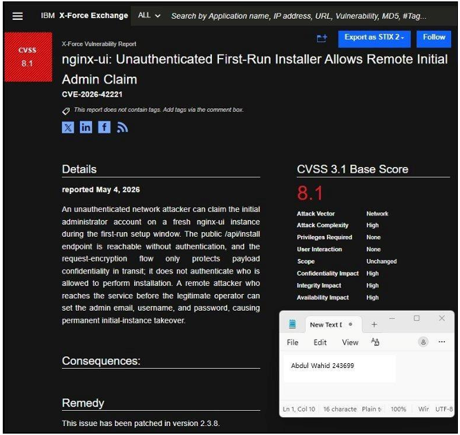
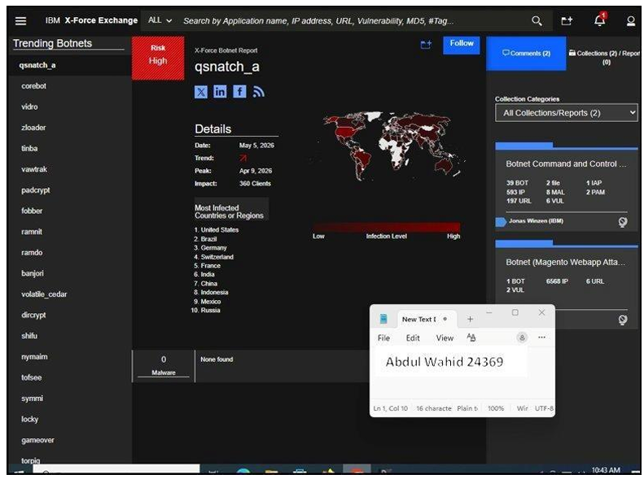
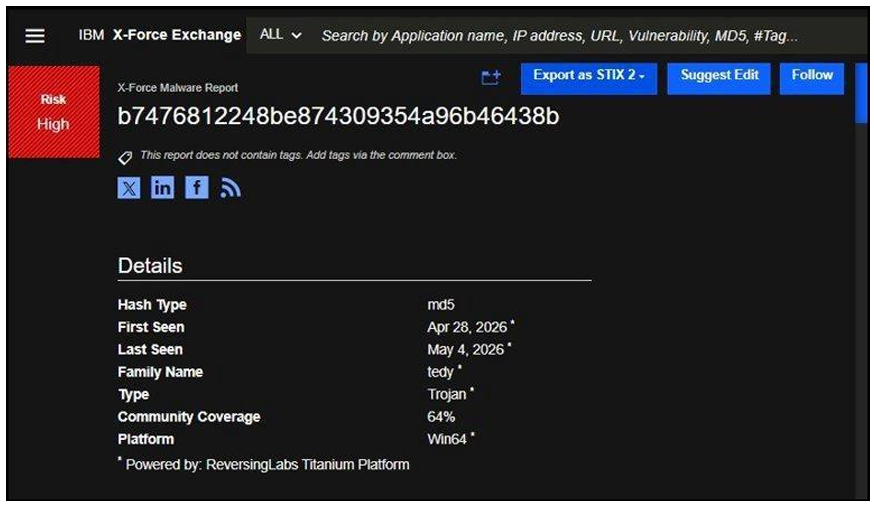
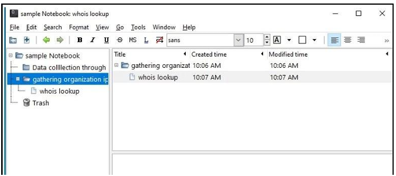

  

<h1>M04 — IBM X-Force Exchange and Reporting</h1>
<h3>Collecting, analysing and sharing intelligence, then documenting it in KeepNote and Word</h3>

 

  

<a href="#overview"><b>Overview</b></a> &nbsp;·&nbsp;
<a href="#tasks-and-results"><b>Tasks</b></a> &nbsp;·&nbsp;
<a href="#evidence"><b>Evidence</b></a> &nbsp;·&nbsp;
<a href="#full-report"><b>Report</b></a>

 

---

## Overview

Two connected labs. The first uses IBM X-Force Exchange for data collection, file analysis and sharing. The second documents findings with KeepNote, exported as an HTML report, and reviews the Cyber Threat Intelligence Report template in Microsoft Word.

 

## Tasks and Results

<table>
<tr><th>Task</th><th>Activity</th><th>Result</th></tr>
<tr><td><b>1</b></td><td>Data collection</td><td>Advisory <i>New Tactics Seen In Smoke Loader</i> reviewed with SHA-256 and IPv4 indicators and 28 reports; vulnerability CVE-2026-42221 (nginx-ui, CVSS 3.1 score 8.1, High); botnet <code>qsnatch_a</code> seen in 121 countries with a peak on 9 April 2026</td></tr>
<tr><td><b>2</b></td><td>Threat analysis with Scan file</td><td>Sample classified as a Trojan of the <code>tedy</code> family, Risk High, Win64, 64% community coverage, MD5 <code>b7476812248be874309354a96b46438b</code></td></tr>
<tr><td><b>3</b></td><td>Sharing</td><td>Collection created with threat type, overview, IoCs, protection and recommendations; shared publicly at TLP:WHITE with Contribute access</td></tr>
<tr><td><b>4</b></td><td>KeepNote report</td><td>Notebook with a Data Collection Through DNS folder and a WhoIs page for the lab practice domain (name servers NS1 and NS2 at Bluehost, IP <code>162[.]241[.]216[.]11</code>); exported to HTML</td></tr>
<tr><td><b>5</b></td><td>Word report template</td><td>Cyber Threat Intelligence Report template and a completed sample reviewed: report details, client details and test details</td></tr>
</table>

 

## Evidence

   
  Task 1: Smoke Loader collection with SHA-256 and IPv4 indicators

   
  Task 1: nginx-ui vulnerability with CVSS 8.1 (High)

   
  Task 1: botnet distribution for qsnatch_a across 121 countries

   
  Task 2: malware report classifying the scanned file as a tedy Trojan

   
  Task 3: sharing options set to TLP:WHITE with public Contribute access

   
  Task 4: exported KeepNote report opened in a browser

 

## Tools

<code>IBM X-Force Exchange</code> <code>KeepNote</code> <code>Microsoft Word</code>

 

## Full Report

📄 **[IBM-X-Force-and-KeepNote.pdf](./IBM-X-Force-and-KeepNote.pdf)**: the X-Force tasks and the KeepNote and Word reporting tasks.

 

⬅ <a href="../README.md"><b>Back to Main Repository</b></a>

