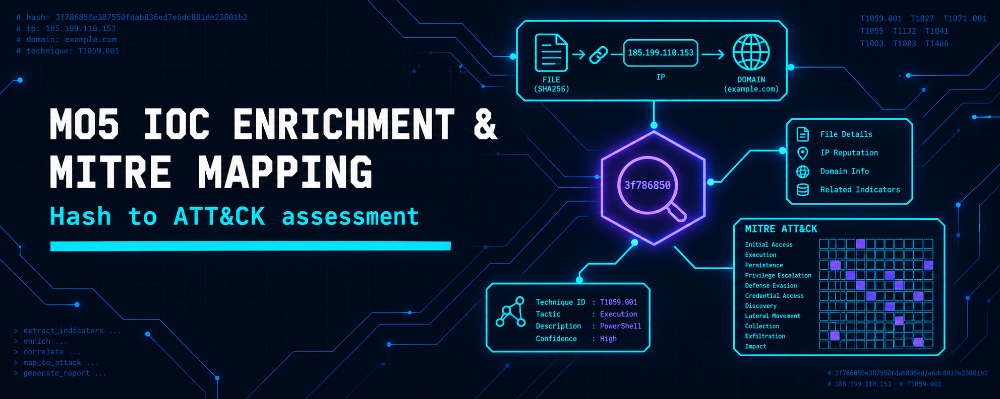
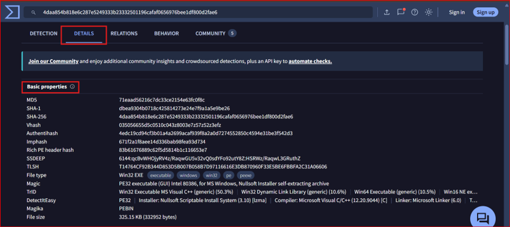
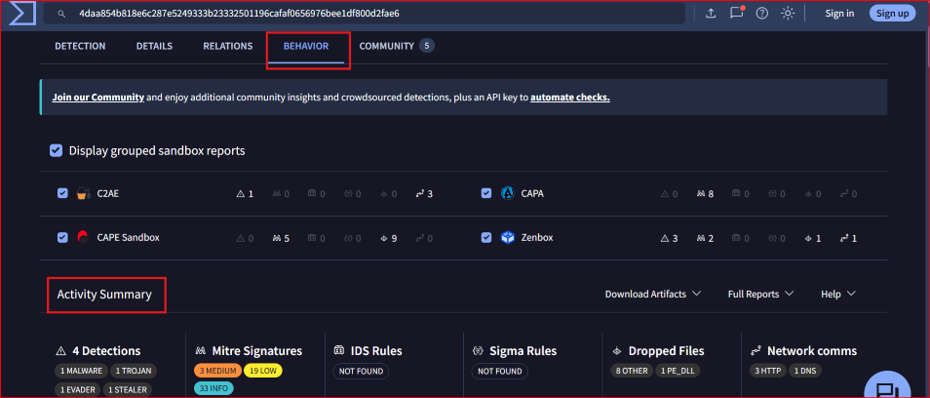
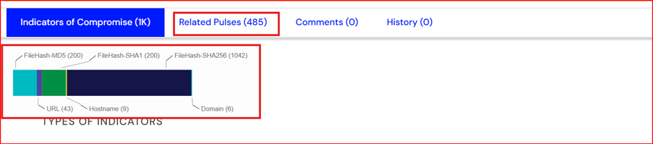
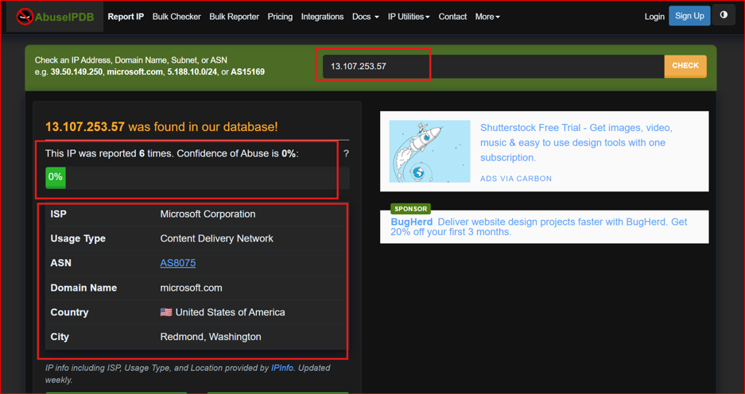
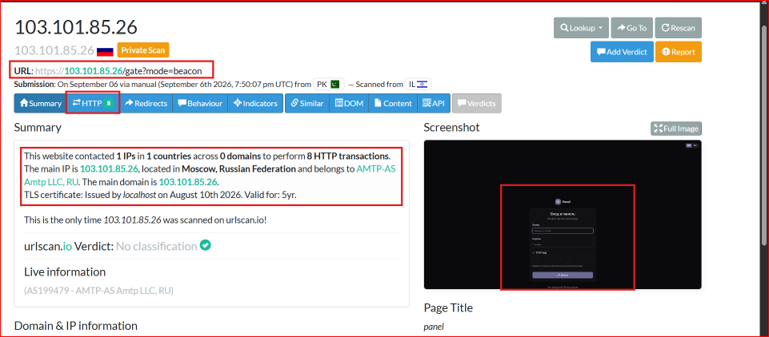
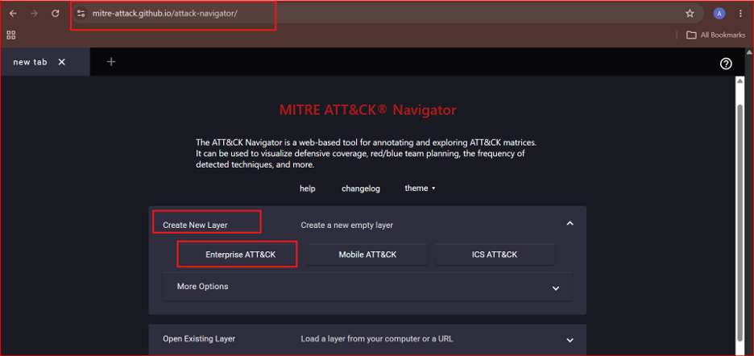

  

<h1>M05 — IOC Enrichment and MITRE Mapping</h1>
<h3>A junior analyst workflow from raw hashes to an ATT&amp;CK-mapped assessment</h3>

 

  

<a href="#overview"><b>Overview</b></a> &nbsp;·&nbsp;
<a href="#tasks-and-results"><b>Findings</b></a> &nbsp;·&nbsp;
<a href="#evidence"><b>Evidence</b></a> &nbsp;·&nbsp;
<a href="#full-report"><b>Report</b></a>

 

---

## Overview

Three public malware hashes from MalwareBazaar are investigated with free OSINT tools: VirusTotal, AlienVault OTX, AbuseIPDB and urlscan.io. The work covers detection and behaviour review, community pulse lookup, pivoting from contacted infrastructure, ATT&CK Navigator mapping, recommended actions and a stated confidence level. Hash-1 showed Trojan, Stealer and Evader behaviour, Hash-2 was confirmed as AgentTesla, and Hash-3 led to related infrastructure.

 

## Tasks and Results

<table>
<tr><th>Hash</th><th>SHA-256</th><th>Finding</th></tr>
<tr><td><b>Hash-1</b></td><td><code>4daa854b818e6c287e5249333b23332501196cafaf0656976bee1df800d2fae6</code></td><td>Trojan, Stealer and Evader behaviour with process injection and autostart persistence; no OTX pulses, one YARA rule; contacted IPs not reported on AbuseIPDB</td></tr>
<tr><td><b>Hash-2</b></td><td><code>c3804a1c09c3e47a63fc9c0ca092e4d7dabc263c8221c3486b06ba0fb9628ec4</code></td><td>Confirmed as AgentTesla through OTX community pulses</td></tr>
<tr><td><b>Hash-3</b></td><td><code>91a67896f3d58d3b3ec5d12a0f45a4678b6983b5033cc0905ad71776f5fd463b</code></td><td>Related IP <code>103[.]101[.]85[.]26</code> and path <code>/gate?mode=beacon</code> match a C2 panel pattern; Russian-hosted, not yet widely blacklisted</td></tr>
</table>

 

### ATT&amp;CK techniques mapped

<table>
<tr><th>ID</th><th>Technique</th><th>Basis</th></tr>
<tr><td><code>T1059</code></td><td>Command and Scripting Interpreter</td><td>Installer-style behaviour on Hash-1</td></tr>
<tr><td><code>T1055</code></td><td>Process Injection</td><td>Flagged in the VirusTotal Behavior tab</td></tr>
<tr><td><code>T1547</code></td><td>Boot or Logon Autostart Execution</td><td>Persistence techniques on Hash-1</td></tr>
<tr><td><code>T1555</code></td><td>Credentials from Password Stores</td><td>Stealer detections on Hash-1</td></tr>
<tr><td><code>T1056</code></td><td>Input Capture (keylogging)</td><td>Sandbox detections on Hash-1</td></tr>
<tr><td><code>T1071</code></td><td>Application Layer Protocol</td><td>Network patterns in the Relations tab</td></tr>
<tr><td><code>T1041</code></td><td>Exfiltration Over C2 Channel</td><td>Typical stealer behaviour</td></tr>
</table>

 

### Assessment

<table>
<tr><th>Item</th><th>Detail</th></tr>
<tr><td><b>Confidence</b></td><td>Medium-High. Multi-vendor detections and sandbox behaviour support Hash-1 and Hash-2; the level is not High because some contacted IPs belonged to legitimate CDNs and OTX had limited pulses on Hash-1</td></tr>
<tr><td><b>Actions</b></td><td>Block all three hashes; hunt for the observed file names; alert on injection and autostart behaviour; block and monitor the related IP and URL path; watch the hosting ASN in proxy and firewall logs</td></tr>
</table>

 

## Evidence

   
  Hash-1: VirusTotal detection tab with ratio and threat labels

   
  Hash-1: behaviour tab with sandbox detections

   
  Hash-2: OTX pulses attributing the sample to AgentTesla

   
  Hash-3 pivot: AbuseIPDB lookup of the related IP

   
  Hash-3 pivot: urlscan.io result for the login panel with the beacon path

   
  ATT&amp;CK Navigator layer with the mapped techniques highlighted

 

## Tools

<code>VirusTotal</code> <code>AlienVault OTX</code> <code>AbuseIPDB</code> <code>urlscan.io</code> <code>MITRE ATT&amp;CK Navigator</code> <code>MalwareBazaar</code>

 

## Full Report

📄 **[IOC-Enrichment-and-MITRE-Mapping.pdf](./IOC-Enrichment-and-MITRE-Mapping.pdf)**: the full investigation with recommended actions and confidence justification.

 

⬅ <a href="../README.md"><b>Back to Main Repository</b></a>

