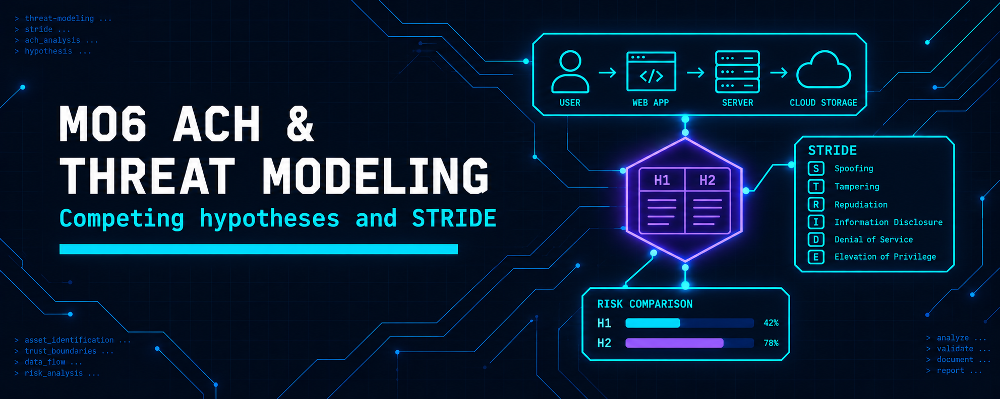
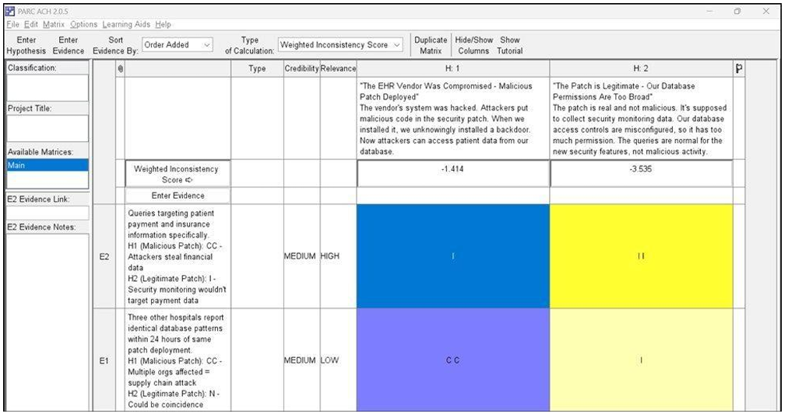
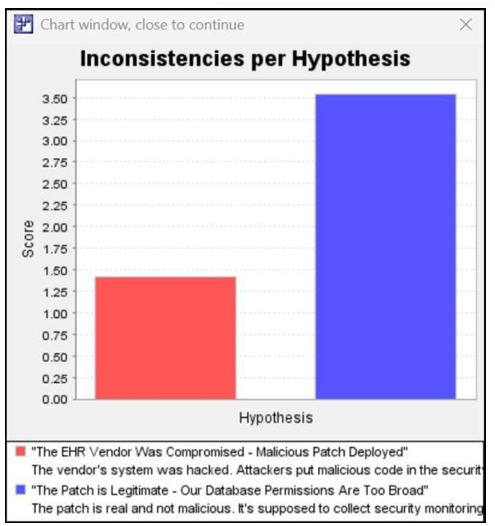
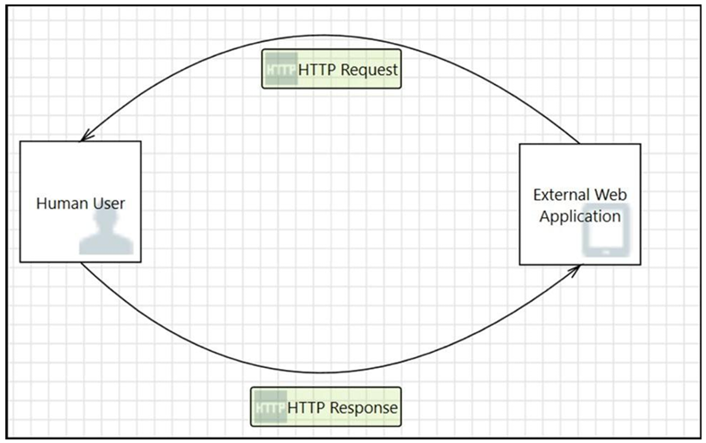
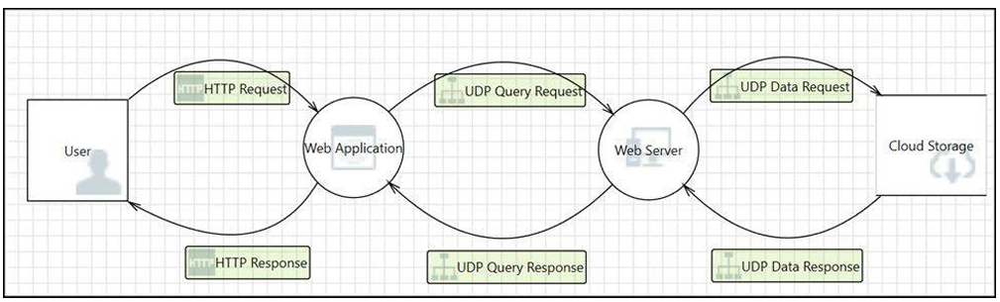
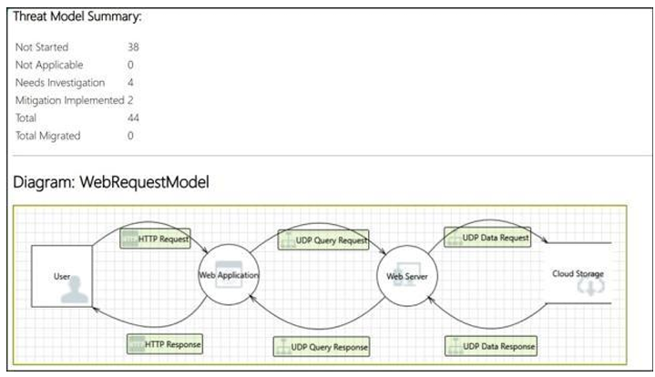

  

<h1>M06 — ACH and Threat Modeling</h1>
<h3>Competing hypotheses on a suspected supply chain patch and STRIDE threat modeling</h3>

 

  

<a href="#overview"><b>Overview</b></a> &nbsp;·&nbsp;
<a href="#tasks-and-results"><b>Results</b></a> &nbsp;·&nbsp;
<a href="#evidence"><b>Evidence</b></a> &nbsp;·&nbsp;
<a href="#full-report"><b>Report</b></a>

 

---

## Overview

Two structured analytic techniques. In the first, PARC ACH 2.0.5 is used to weigh two explanations for suspicious database activity after a vendor security patch. In the second, Microsoft Threat Modeling Tool 2016 is used to build a small request and response model from scratch, then to run a prebuilt WebRequestModel through the STRIDE knowledge base and generate a full report.

 

## Tasks and Results

<table>
<tr><th>Lab</th><th>Activity</th><th>Result</th></tr>
<tr><td><b>ACH</b></td><td>Hypotheses: H1 the EHR vendor was compromised and a malicious patch was deployed; H2 the patch is legitimate and database permissions are too broad</td><td>Two evidence items rated: queries aimed at payment and insurance data, and identical patterns at three other hospitals within 24 hours</td></tr>
<tr><td><b>ACH</b></td><td>Weighted inconsistency per hypothesis</td><td>H1 scored 1.414 and H2 scored 3.535; the lower score marks H1, the malicious patch, as the better supported explanation</td></tr>
<tr><td><b>Threat model</b></td><td>Built a Human User to External Web Application model with HTTP Request and Response flows</td><td>Basic request and response lifecycle modeled; flows named for traceable threats</td></tr>
<tr><td><b>Threat model</b></td><td>WebRequestModel: User, Web Application, Web Server and Cloud Storage; template SDL TM Knowledge Base (Core) v4.1.0.9</td><td>Full report generated with 44 threats: 38 Not Started, 4 Needs Investigation, 2 Mitigation Implemented</td></tr>
</table>

 

## Evidence

   
  ACH: matrix with evidence ratings applied to both hypotheses

   
  ACH: inconsistencies per hypothesis, H1 lower than H2

   
  Threat model: completed HTTP Request and Response model

   
  Threat model: WebRequestModel data flow diagram

   
  Threat model: report summary showing 44 threats by state

 

## Tools

<code>PARC ACH 2.0.5</code> <code>Microsoft Threat Modeling Tool 2016</code> <code>STRIDE</code>

 

## Full Report

📄 **[ACH-and-Threat-Modeling.pdf](./ACH-and-Threat-Modeling.pdf)**: the ACH and threat modeling labs with every step and figure.

 

⬅ <a href="../README.md"><b>Back to Main Repository</b></a>

