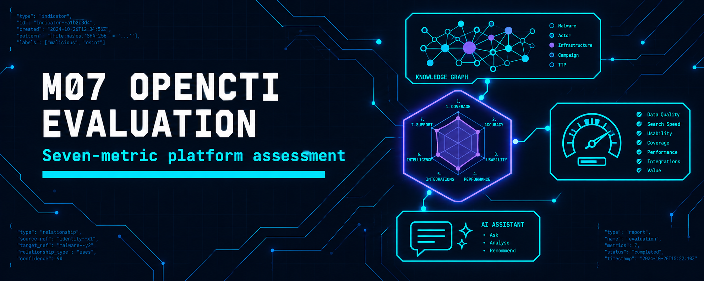
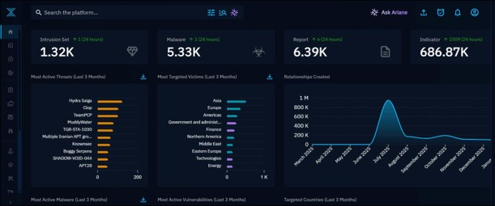
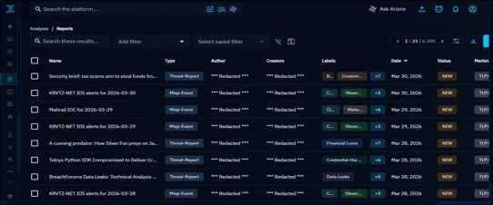
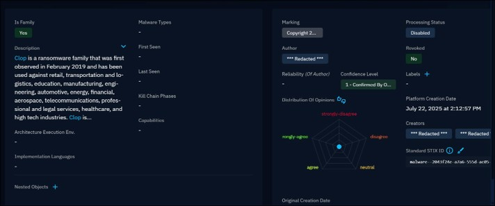
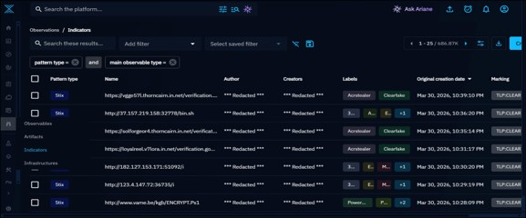
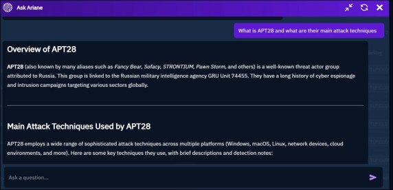
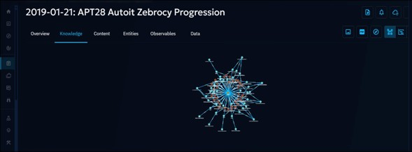

  

<h1>M07 — OpenCTI Evaluation</h1>
<h3>A seven-metric assessment of an open-source threat intelligence platform on live demo data</h3>

 

  

<a href="#overview"><b>Overview</b></a> &nbsp;·&nbsp;
<a href="#metrics-and-results"><b>Metrics</b></a> &nbsp;·&nbsp;
<a href="#evidence"><b>Evidence</b></a> &nbsp;·&nbsp;
<a href="#full-report"><b>Report</b></a>

 

---

## Overview

OpenCTI, developed by Filigran, is assessed through its public demo environment on 30 March 2026. It was chosen for native STIX 2.1 and TAXII 2.1 support, MITRE ATT&amp;CK integration, the built-in Ariane AI assistant and live data. The assessment scores seven metrics from direct observation, then covers strengths, limitations, recommendations and a comparison with static platforms.

 

## Metrics and Results

<table>
<tr><th>#</th><th>Metric</th><th>Key evidence</th><th>Rating</th></tr>
<tr><td><b>1</b></td><td>Mean Time to Detect</td><td>686,870 indicators; 1,509 new in 24 hours; newest entry the same evening</td><td>Strong</td></tr>
<tr><td><b>2</b></td><td>Encounter Rate</td><td>1,320 intrusion sets and 5,330 malware entities; top 10 threats auto-ranked</td><td>Strong</td></tr>
<tr><td><b>3</b></td><td>False Positive Rate</td><td>Confidence scoring, TLP markings and revocation flags; Clop rated "1 - Confirmed By Other Sources"</td><td>Strong</td></tr>
<tr><td><b>4</b></td><td>Threat Classification Accuracy</td><td>Clop tracked as a family with 3 variants; 94 documented attacker tools</td><td>Strong</td></tr>
<tr><td><b>5</b></td><td>Escalation Rate</td><td>Most Active Threats widget; about 900,000 relationships at the July 2025 peak; 228 relationships on Clop</td><td>Strong</td></tr>
<tr><td><b>6</b></td><td>Detection Success Rate</td><td>6,390 reports; 38 on APT28; 26 CVEs linked to Clop including 2026 entries</td><td>Strong</td></tr>
<tr><td><b>7</b></td><td>Analyst Feedback and AI</td><td>Ariane attributed APT28 to GRU Unit 74455 with four aliases; opinion radar and knowledge graph</td><td>Strong</td></tr>
</table>

 

### Limitations and recommendations

<table>
<tr><th>Observed limitation</th><th>Recommendation made</th></tr>
<tr><td>Redacted author fields in the demo limit provenance checks</td><td>Formal TLP governance enforced through role-based access control</td></tr>
<tr><td>AlienVault supplied 100% of Clop analyses, a single-source dependency</td><td>Deploy 5 to 8 connectors across commercial, open-source, government and ISAC feeds</td></tr>
<tr><td>Steep learning curve across the entity model</td><td>Standard procedures for Ariane use and an analyst opinion programme</td></tr>
<tr><td>Self-hosting needs Elasticsearch, Redis, RabbitMQ and MinIO, with 16 GB+ RAM advised</td><td>Map ATT&amp;CK techniques to SIEM detection rules to close the loop</td></tr>
</table>

 

## Evidence

   
  Dashboard: intrusion sets, malware, reports and indicators with 24-hour change

   
  Metric 1: indicators created on the day of the assessment

   
  Metric 3: Clop malware profile with confidence level and revocation status

   
  Metric 6: APT28 reports, 38 in total

   
  Metric 7: Ariane AI overview of APT28

   
  Metric 7: knowledge graph of the APT28 Zebrocy report

 

## Tools

<code>OpenCTI</code> <code>STIX 2.1</code> <code>MITRE ATT&amp;CK</code>

 

## Full Report

📄 **[OpenCTI-Evaluation.pdf](./OpenCTI-Evaluation.pdf)**: the full platform assessment with comparative analysis and references.

 

⬅ <a href="../README.md"><b>Back to Main Repository</b></a>

