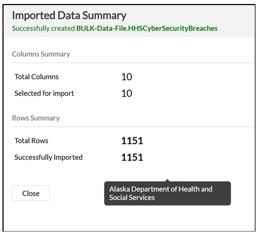
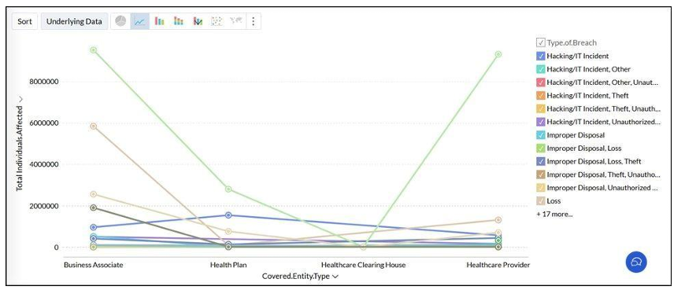
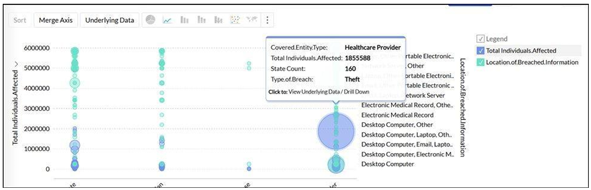
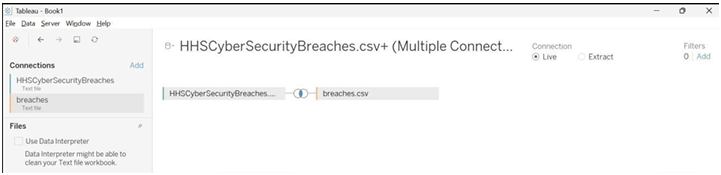
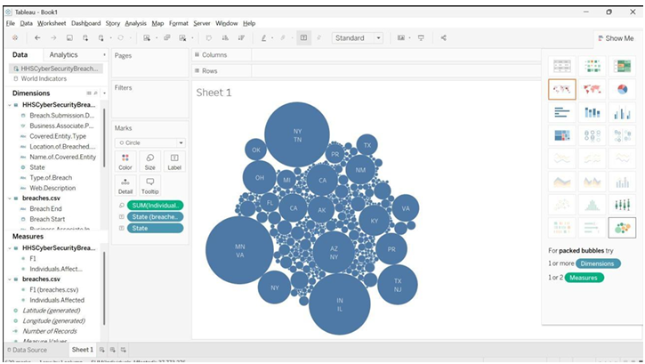
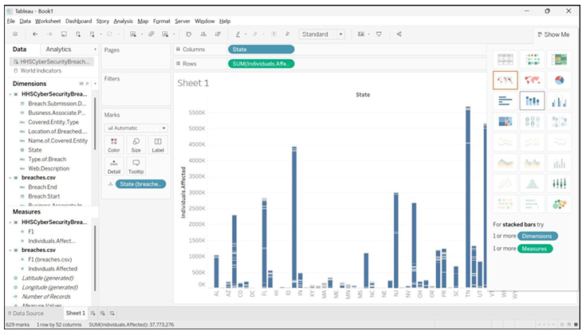
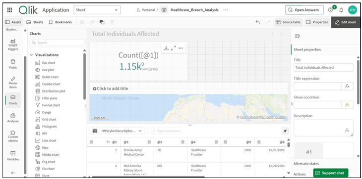

  

<h1>M08 — Healthcare Breach Analysis (Zoho, Tableau, Qlik)</h1>
<h3>One breach dataset, three analytics platforms</h3>

 

  

<a href="#overview"><b>Overview</b></a> &nbsp;·&nbsp;
<a href="#tasks-and-results"><b>Results</b></a> &nbsp;·&nbsp;
<a href="#evidence"><b>Evidence</b></a> &nbsp;·&nbsp;
<a href="#full-report"><b>Reports</b></a>

 

---

## Overview

The HHS Cyber Security Breaches dataset (1,151 records of healthcare breaches reported to the US Department of Health and Human Services, 10 columns) is analysed in Zoho Analytics, Tableau Desktop 2018.1 and Qlik Cloud Analytics. The aim is to show how bulk data is ingested, joined, filtered and visualised to expose patterns that raw tables hide.

 

## Tasks and Results

<table>
<tr><th>Tool</th><th>Activity</th><th>Result</th></tr>
<tr><td><b>Zoho Analytics</b></td><td>Imported the CSV into a workspace; built line and bubble charts by entity type, breach type and breach location</td><td>All 1,151 rows and 10 columns imported; Healthcare Providers show the highest impact, with Hacking/IT Incident peaking above 9 million individuals</td></tr>
<tr><td><b>Tableau</b></td><td>Joined <code>HHSCyberSecurityBreaches.csv</code> and <code>breaches.csv</code> (inner join on F1); filtered Individuals Affected to 1,500 to 2,000</td><td>Filter returned 90 rows</td></tr>
<tr><td><b>Tableau</b></td><td>Packed bubbles and stacked bar charts by state</td><td>Total of 37,773,276 individuals affected; Tennessee the tallest bar, followed by Indiana and Illinois, New York and Texas</td></tr>
<tr><td><b>Qlik Cloud</b></td><td>Created the <i>Healthcare_Breach_Analysis</i> app with a KPI and a map on the sheet <i>Total Individuals Affected</i></td><td>About 1,150 records loaded; KPI count 1.15k; column headers were not detected, so fields appear as <code>@1</code>, <code>@10</code></td></tr>
</table>

 

## Evidence

   
  Zoho: import summary with 1,151 rows and 10 columns

   
  Zoho: individuals affected by entity type and breach type

   
  Zoho: multi-dimensional bubble chart with tooltip

   
  Tableau: inner join of the two datasets on F1

   
  Tableau: packed bubbles of individuals affected by state

   
  Tableau: stacked bar chart, Tennessee tallest

   
  Qlik: sheet with KPI count and map

 

## Tools

<code>Zoho Analytics</code> <code>Tableau Desktop 2018.1</code> <code>Qlik Cloud Analytics</code>

 

## Full Reports

📄 **[Tableau-and-Qlik.pdf](./Tableau-and-Qlik.pdf)**: the Tableau and Qlik parts with every step and figure.

📄 **[ACH-and-Threat-Modeling.pdf](../M06-ACH-and-Threat-Modeling/ACH-and-Threat-Modeling.pdf)**: the Zoho Analytics part is Lab 3 of this report.

 

⬅ <a href="../README.md"><b>Back to Main Repository</b></a>

