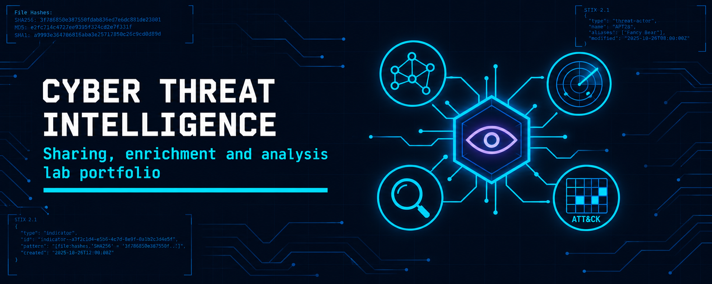

<div align="center">



<br><br>

<h1>Cyber Threat Intelligence Lab Portfolio</h1>
<h3>Intelligence sharing, IOC development, enrichment, platform evaluation and threat data analytics</h3>

<br>


<br><br>

<a href="#overview"><b>Overview</b></a> &nbsp;·&nbsp;
<a href="#labs"><b>Labs</b></a> &nbsp;·&nbsp;
<a href="#key-results"><b>Results</b></a> &nbsp;·&nbsp;
<a href="#tools"><b>Tools</b></a> &nbsp;·&nbsp;
<a href="#lab-environment"><b>Environment</b></a> &nbsp;·&nbsp;
<a href="#repository-structure"><b>Structure</b></a> &nbsp;·&nbsp;
<a href="#contact"><b>Contact</b></a>

</div>

<br>

---

## Overview

This repository documents my hands-on work in cyber threat intelligence (CTI), completed as part of the Certified Threat Intelligence Analyst (CTIA) course material. It covers 8 labs across the intelligence lifecycle: sharing indicators on AlienVault OTX, IOC Bucket and IBM X-Force Exchange, writing a YARA rule and building OpenIOC files, enriching hashes and IPs and mapping behaviour to MITRE ATT&CK, structured analysis (ACH and threat modeling), an OpenCTI platform evaluation, and a healthcare breach dataset analysed in Zoho Analytics, Tableau and Qlik. Every lab has its own folder with a README, its PDF report and key evidence screenshots.

<table>
<tr><th>Item</th><th>Detail</th></tr>
<tr><td><b>Focus</b></td><td>Indicator sharing, custom IOC and YARA development, enrichment and pivoting, ATT&amp;CK mapping, structured analytic techniques, TI platform evaluation, data visualisation</td></tr>
<tr><td><b>Labs</b></td><td>8 (4 intelligence sharing, 3 analysis and platforms, 1 threat data analytics)</td></tr>
<tr><td><b>Techniques</b></td><td>Pulse and collection publishing, YARA rule writing, OpenIOC authoring, hash and IP reputation checks, infrastructure pivoting, MITRE ATT&amp;CK Navigator mapping, ACH, STRIDE threat modeling, STIX-based platform assessment, bulk data analysis</td></tr>
<tr><td><b>Format</b></td><td>One folder per lab with <code>README.md</code>, the PDF report named after the lab, and <code>images/</code></td></tr>
<tr><td><b>Safety</b></td><td>Reports only. No malware samples are published and network indicators are defanged</td></tr>
</table>

<br>

## Labs

<table>
<tr><th>#</th><th>Lab</th><th>Focus</th><th>Core Tools</th></tr>
<tr><td>M01</td><td><a href="./M01-AlienVault-OTX-and-IOC-Bucket/README.md">AlienVault OTX and IOC Bucket</a></td><td>Hash search, pulse creation and IOC upload to community platforms</td><td><code>AlienVault OTX</code> <code>IOC Bucket</code></td></tr>
<tr><td>M02</td><td><a href="./M02-AlienVault-OTX-and-YARA/README.md">AlienVault OTX and YARA</a></td><td>Full lifecycle: collection, endpoint scanning, custom YARA indicator, sharing</td><td><code>AlienVault OTX</code> <code>YARA</code> <code>MalwareBazaar</code></td></tr>
<tr><td>M03</td><td><a href="./M03-Custom-IOC-Development-OpenIOC/README.md">Custom IOC Development</a></td><td>Four OpenIOC files built from real samples and validated online</td><td><code>Mandiant IOCe</code> <code>IOC Bucket</code> <code>VirusTotal</code> <code>MalwareBazaar</code></td></tr>
<tr><td>M04</td><td><a href="./M04-IBM-X-Force-and-Reporting/README.md">IBM X-Force and Reporting</a></td><td>Collection, analysis and sharing, then report writing</td><td><code>IBM X-Force Exchange</code> <code>KeepNote</code> <code>Microsoft Word</code></td></tr>
<tr><td>M05</td><td><a href="./M05-IOC-Enrichment-and-MITRE-Mapping/README.md">IOC Enrichment and MITRE Mapping</a></td><td>Three hashes enriched, infrastructure pivoting, ATT&amp;CK mapping and a confidence statement</td><td><code>VirusTotal</code> <code>AlienVault OTX</code> <code>AbuseIPDB</code> <code>urlscan.io</code> <code>ATT&amp;CK Navigator</code></td></tr>
<tr><td>M06</td><td><a href="./M06-ACH-and-Threat-Modeling/README.md">ACH and Threat Modeling</a></td><td>Competing hypotheses on a suspected supply chain patch and STRIDE threat modeling</td><td><code>PARC ACH</code> <code>Microsoft Threat Modeling Tool 2016</code></td></tr>
<tr><td>M07</td><td><a href="./M07-OpenCTI-Evaluation/README.md">OpenCTI Evaluation</a></td><td>Seven-metric assessment of an open-source TI platform on live demo data</td><td><code>OpenCTI</code></td></tr>
<tr><td>M08</td><td><a href="./M08-Healthcare-Breach-Analysis-Zoho-Tableau-Qlik/README.md">Healthcare Breach Analysis</a></td><td>One breach dataset analysed in three analytics platforms</td><td><code>Zoho Analytics</code> <code>Tableau Desktop</code> <code>Qlik Cloud Analytics</code></td></tr>
</table>

<br>

## Key Results

<table>
<tr><th>Lab</th><th>Result</th></tr>
<tr><td><b>M01</b></td><td>An MD5 hash found in 50 OTX pulses; a new pulse with MD5, SHA-1 and SHA-256 indicators published at TLP:GREEN, and the same IOC contributed to IOC Bucket</td></tr>
<tr><td><b>M02</b></td><td>OTX endpoint agent registered on a Windows 10 VM; YARA rule <code>MAL_Linux_ELF_Hash_Exact</code> passed the OTX false-positive test and was published in a TLP:WHITE pulse</td></tr>
<tr><td><b>M03</b></td><td>Four <code>.ioc</code> files built in Mandiant IOCe (Snake Keylogger, Mirai ELF32, an installer dropper, an ELF64 libsystemd sample) and rebuilt in IOC Bucket for validation</td></tr>
<tr><td><b>M04</b></td><td>28 reports reviewed in an IBM X-Force advisory; a scanned file classified as a Trojan (tedy family, High risk) and shared as a public TLP:WHITE collection; findings exported as an HTML report with KeepNote</td></tr>
<tr><td><b>M05</b></td><td>Three hashes enriched across four sources; Hash-2 confirmed as AgentTesla, a suspected Russian-hosted C2 panel at <code>103[.]101[.]85[.]26</code> found by pivoting, 7 ATT&amp;CK techniques mapped, confidence Medium-High</td></tr>
<tr><td><b>M06</b></td><td>ACH scored the malicious-patch hypothesis lowest on inconsistency (1.414 against 3.535); the threat model produced 44 STRIDE threats: 38 Not Started, 4 Needs Investigation, 2 Mitigation Implemented</td></tr>
<tr><td><b>M07</b></td><td>OpenCTI demo assessed on 30 March 2026: 686,870 indicators with 1,509 added in 24 hours; rated Strong on all seven metrics, with limits noted on provenance, source diversity and self-hosting cost</td></tr>
<tr><td><b>M08</b></td><td>1,151 HHS breach records imported into Zoho Analytics; Tableau totalled 37,773,276 individuals affected with Tennessee highest, and a join plus filter returned 90 rows; Qlik app built with a KPI and map</td></tr>
</table>

<br>

## Tools

<table>
<tr><th>Category</th><th>Tools</th></tr>
<tr><td><b>Intelligence sharing</b></td><td><code>AlienVault OTX</code> <code>IOC Bucket</code> <code>IBM X-Force Exchange</code></td></tr>
<tr><td><b>Samples and reputation</b></td><td><code>MalwareBazaar</code> <code>VirusTotal</code> <code>AbuseIPDB</code> <code>urlscan.io</code></td></tr>
<tr><td><b>Indicator development</b></td><td><code>YARA</code> <code>Mandiant IOCe</code> <code>OpenIOC</code></td></tr>
<tr><td><b>Frameworks</b></td><td><code>MITRE ATT&amp;CK Navigator</code> <code>STRIDE</code> <code>STIX 2.1</code></td></tr>
<tr><td><b>Structured analysis</b></td><td><code>PARC ACH</code> <code>Microsoft Threat Modeling Tool 2016</code></td></tr>
<tr><td><b>TI platform</b></td><td><code>OpenCTI</code></td></tr>
<tr><td><b>Reporting</b></td><td><code>KeepNote</code> <code>Microsoft Word</code></td></tr>
<tr><td><b>Data analytics</b></td><td><code>Zoho Analytics</code> <code>Tableau Desktop</code> <code>Qlik Cloud Analytics</code></td></tr>
</table>

<br>

## Lab Environment

<table>
<tr><th>Item</th><th>Detail</th></tr>
<tr><td><b>Analysis host</b></td><td>Windows 10 virtual machine (Windows Defender disabled for the endpoint and sample exercises in M02)</td></tr>
<tr><td><b>Platforms</b></td><td>Free community or trial accounts on OTX, IOC Bucket, IBM X-Force Exchange, Zoho, Tableau and Qlik; the public OpenCTI demo</td></tr>
<tr><td><b>Sample sources</b></td><td>MalwareBazaar, with reputation data from VirusTotal</td></tr>
<tr><td><b>Datasets</b></td><td>HHS Cyber Security Breaches (public US Department of Health and Human Services data)</td></tr>
<tr><td><b>Handling</b></td><td>Samples were used only to extract hashes and file properties; none are stored in this repository</td></tr>
</table>

<br>

## Repository Structure

```
cyber-threat-intelligence-lab-portfolio/
├── README.md
├── LICENSE
├── .gitignore
├── images/
│   └── banner.png
├── M01-AlienVault-OTX-and-IOC-Bucket/
│   ├── README.md
│   ├── OTX-and-IOC-Bucket.pdf
│   └── images/
│       └── cover.png
├── M02-AlienVault-OTX-and-YARA/
│   ├── README.md
│   ├── OTX-and-YARA.pdf
│   └── images/
│       └── cover.png
├── M03-Custom-IOC-Development-OpenIOC/
│   ├── README.md
│   ├── Custom-IOC-Development.pdf
│   └── images/
│       └── cover.png
├── M04-IBM-X-Force-and-Reporting/
│   ├── README.md
│   ├── IBM-X-Force-and-KeepNote.pdf
│   └── images/
│       └── cover.png
├── M05-IOC-Enrichment-and-MITRE-Mapping/
│   ├── README.md
│   ├── IOC-Enrichment-and-MITRE-Mapping.pdf
│   └── images/
│       └── cover.png
├── M06-ACH-and-Threat-Modeling/
│   ├── README.md
│   ├── ACH-and-Threat-Modeling.pdf
│   └── images/
│       └── cover.png
├── M07-OpenCTI-Evaluation/
│   ├── README.md
│   ├── OpenCTI-Evaluation.pdf
│   └── images/
│       └── cover.png
└── M08-Healthcare-Breach-Analysis-Zoho-Tableau-Qlik/
    ├── README.md
    ├── Tableau-and-Qlik.pdf
    ├── Zoho-Analytics.pdf
    └── images/
        └── cover.png
```

Each module folder holds its `README.md`, its PDF report and an `images/` folder with `cover.png` and the evidence screenshots.

<br>

## License

**© 2026 Abdul Wahid**. Licensed under [**CC BY-NC-ND 4.0**](./LICENSE) (Attribution, NonCommercial, NoDerivatives). You may view, reference and share a link to this work with credit. Commercial use and redistributing modified copies are not permitted.

<br>

## Disclaimer

All work was performed for education using free or trial accounts and public data. No malware samples or payloads are included in this repository, only reports and screenshots. Network indicators are written in defanged form and must not be treated as safe links. File hashes are published as identifiers only. Indicators shared on community platforms were limited to public sample hashes.

<br>

## Contact

<p align="center">
  <b>Abdul Wahid</b>
</p>

<p align="center">
  <a href="mailto:a.wahid7860668@gmail.com"></a>
  <a href="https://www.linkedin.com/in/abdul-wahid022"></a>
  <a href="https://github.com/abdul-wahid022"></a>
</p>
